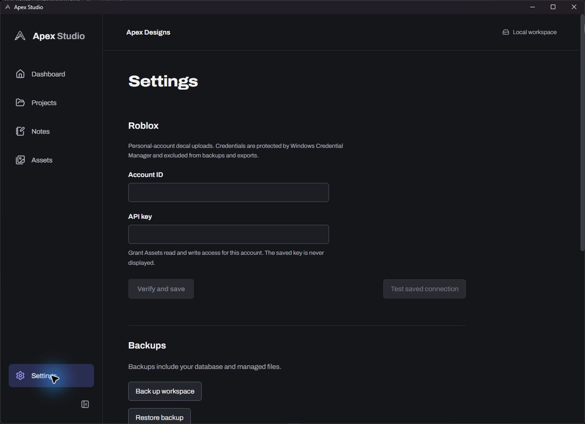

# Roblox decals and livery-first publishing

Development follow-up, 2026-10-25.

## Workflow

1. Settings → Roblox: enter your personal Roblox account ID and API key, then Verify and save. The key must be enabled, unexpired, authorized by that account, and permit Assets read/write for it. Introspection checks these without a test upload. Test saved connection and Remove credentials are available.
2. Select a livery folder or open it and choose Upload to Roblox. Review its account, assigned sides, filenames and current upload state. Only assigned textures are uploaded; covers and unassigned images are excluded. Names derive from the livery and side. Source files are unchanged.
3. Upload missing textures. Each exact file hash/account pair retains its Decal asset ID, operation, result and moderation state. Successful files survive failures elsewhere. Check pending operations again with Upload missing / check status. Stop after current file stops before the next request; it cannot undo a request already received by Roblox.
4. Publishing → Liveries: choose a project livery and Include livery. Existing decal IDs populate automatically. Missing uploads prompt Upload and include / Skip this livery. Skipping leaves the rest of the draft intact. Colour and opacity remain editable; linked sides/IDs are read-only. Refresh Roblox IDs reloads the current texture versions.
5. Add the post's Details and separate ERLCX Previews, save the draft, then Review → Export for ERLCX extension. Import the `.apexpublish` file into the manually installed Chrome assistant. Fill current step on ERLCX, review it and continue manually. No final posting is automated.

Manual existing decal IDs remain available under Use existing decal IDs manually. Complete imported project packages retain IDs as manual snapshots, stripping source-workspace links; reselect the imported livery to associate new uploads. Workspace backups preserve upload records and draft links, but never credentials.

## Boundaries and recovery

Uploads request assetType Decal and validate the returned type, owner and assetId. Image IDs are never substituted. The creation request uses expectedPrice 0. PNGs up to and including 8000 × 8000 pixels and 20 MiB are accepted; any dimension of 8001 or above is rejected. Existing PNG decoding/allocation limits remain enforced.

Each POST is preceded by a durable claim. The operation reference is saved before polling. A timeout or app interruption without an operation is marked uncertain and is never silently retried, preventing likely duplicates. Check Creator Dashboard and use manual decal IDs to recover such a case. Definite HTTP failures can be retried; a known processing failure clears its operation for the next explicit retry. Pending operations are polled a bounded number of times per request and retained for later checking. No background polling is performed.

Decals cannot be updated in place through this flow: revised file bytes create new uploads. Export validates linked hashes, sides and IDs against the current livery so stale texture-version IDs cannot silently leave the app. Rejected moderation prevents automatic inclusion; reviewing/unknown is displayed distinctly from approval and may not yet work in ER:LC. The extension receives only the public codes and selected media, never upload-operation details, credentials or private source links.

## Credential handling

The account ID and API key settings are stored together as a secret in Windows Credential Manager, outside the workspace. The frontend receives the account ID/configured flag, never the stored API key. Replacing credentials verifies the new pair before replacing the old one. Key inputs are masked and cleared after successful saving. Native HTTP headers are marked sensitive; provider bodies and keys are not logged or echoed in error messages. Temporary owned secret buffers are zeroized where supported. Account IDs used as upload-owner metadata are public identifiers, not API credentials.

The native Rust adapter alone contacts the fixed HTTPS Roblox endpoints; redirects are disabled, replies are size-bounded and timeouts are applied. No frontend network permission, Roblox cookie, browser session or local HTTP bridge is used. A mutex serializes credential changes and upload requests. Secure settings currently require Windows. This is personal-account use; group uploads and OAuth onboarding for a distributed third-party service are not implemented.

## Verification and remaining limits

- 29 Rust tests: core 6, storage 19, native adapter 4. Coverage includes account/scope validation, multipart Decal/owner/PNG request against a local HTTP server, strict Decal response parsing, Windows Credential Manager round-trip with a disposable dummy record, duplicate-claim prevention, backup persistence, changed-texture and stale-export rejection, and real 8000 × 8000 PNG acceptance plus 8001-wide/tall rejection.
- 35 frontend/extension tests, including masked credential input/clearing, explicit upload request, skip without upload, automatic decal-ID import, and read-only linked IDs. Production/native builds and workspace Clippy with warnings denied pass.
- Native settings, upload review and livery-first publishing inspected. Existing workspace migrated to schema 6 with an automatic pre-migration backup; SQLite integrity and foreign keys pass, existing notes unchanged.
- No actual Roblox upload was performed during verification. A configured account was present at final native review; its key was not displayed or exported. Authenticated end-to-end upload behavior still needs an explicitly chosen livery test. Local fixtures verify the request/response contract, not live moderation or access.
- The earlier Chrome extension's full live Media/Codes autofill verification remains pending. No ERLCX draft or post was submitted.

## Sources

[Roblox asset usage guide](https://create.roblox.com/docs/cloud/guides/usage-assets), [Open Cloud asset schema](https://github.com/Roblox/creator-docs/blob/main/content/en-us/reference/cloud/assets/v1.json), [API-key introspection](https://create.roblox.com/docs/cloud/auth/api-keys). The inclusive 8000-pixel boundary follows the user's confirmed requirement and is covered by a real file test; Roblox's server remains authoritative for each upload.

Native final review confirmed the per-selection Upload to Roblox action, assigned side filenames, inclusive size hint, and the separate Upload and include / Skip this livery prompt. The test livery was skipped; no upload or publishing-draft mutation was performed during this review.

## Superseding queue workflow, 2026-10-27

The global Roblox tab now owns persistent multi-livery upload batches; project shortcuts open it with a livery selected. The project Publishing tab is labelled ERLCX and links to Roblox when IDs are missing. New uploads use two sequential Decal passes; existing selected IDs remain until pass two succeeds. The upload mutex and stop-after-current-file UI described above have been replaced. See [current implementation and measured import performance](ROBLOX-QUEUE-PERFORMANCE.md).
