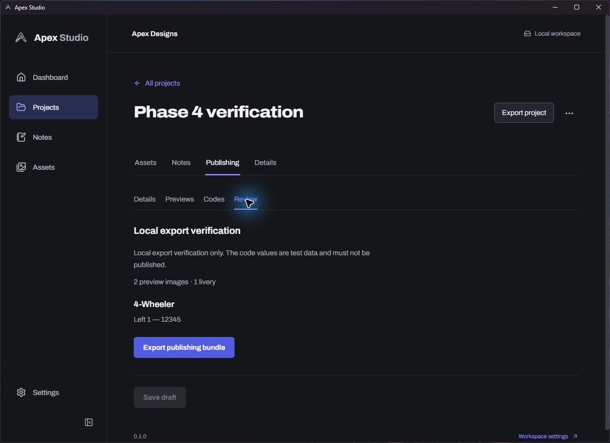
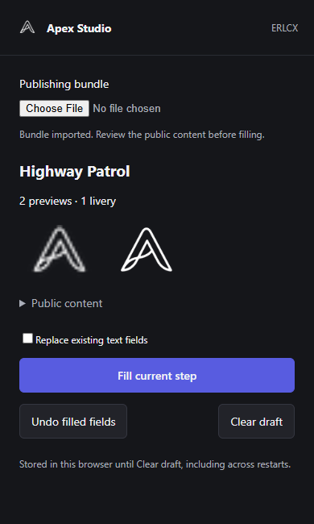

# Phase 5 — Publishing preparation and ERLCX assistant

Development implementation, 2026-10-22. Full live Media/Codes autofill is still pending manual Chrome verification.

## Delivered

- Project Publishing tab with separate Details, Previews, Codes and Review sections, explicit save/discard and revision conflict protection.
- User-written title, description, tags and optional YouTube URL. Two to ten ordered PNG previews, from project assets or managed copies of selected files. First preview is the cover.
- Vehicle-specific code rows, side slots, existing decal IDs, primary/optional secondary colours and opacity. Project liveries can supply vehicle/slot structure; Roblox uploads are not implemented here.
- Export requires a saved, complete draft. A version-1 `.apexpublish` ZIP contains only allowlisted public metadata and selected hash-checked PNGs; no notes, project IDs, private paths, credentials or unrelated files.
- Schema 5 stores publishing drafts and media references. Existing workspaces receive an automatic pre-migration backup. Workspace backups include both tables and files; embedded project packages use version 3 and preserve publishing data. Older packages remain readable.
- Manifest V3 Chrome assistant with manual unpacked installation and manual updates. It imports the bundle and fills only the current ERLCX livery wizard page on request. Unknown layouts stop; existing text is preserved unless replacement is requested. Images are not removed automatically. Undo is best-effort and preserves subsequent user edits.
- Continue, Save Draft, guidelines, paid settings, scheduling and final publication remain manual. No automatic extension installation, credentials, local server, telemetry or background network requests.

## Distribution and retention

Run `npm run build:extension`. Extract `dist/apex-erlcx-extension-0.1.0.zip`, then use Chrome Extensions → Developer mode → Load unpacked. Select the extracted folder. For updates, replace its files, Reload the extension and refresh ERLCX. Instructions and limitations: ../../apps/erlcx-extension/README.md.

The extension retains one imported bundle and its images in IndexedDB across browser restarts until Clear draft. Clearing does not remove form values already written on ERLCX; refresh other filled tabs to remove their in-memory undo state. Image selection can initiate ERLCX uploads immediately, so filling always requires a user action. Only activeTab and scripting permissions are declared.

## Verification

- 23 Rust tests; 30 frontend/extension tests. Production frontend and extension builds pass. Rust formatting and workspace Clippy with warnings denied pass.
- Tests cover draft validation/conflicts, publishing export, package/backup round trips, archive bounds/path/hash validation, React-compatible setters, dynamic code rows, portalled colour pickers, media staging, step-change guards, idempotence, existing values and best-effort undo.
- Real native app: saved a clearly labelled local verification draft in the existing two-file verification project; export stayed disabled until save. Native Save As produced a bundle successfully parsed and hash-verified by the extension reader. Test decal ID 12345 is local test data and must not be published.
- Actual workspace migration: schema 5, SQLite integrity OK, no foreign-key errors. Existing notes match the automatic pre-migration backup exactly.
- Popup tested in an isolated local browser fixture, including image loading, bundle display and Clear draft. No extension was installed into the user's Chrome profile.
- Current signed-in ERLCX Categories/Details/Media DOM inspected. Current public upload JavaScript checked for Codes controls and colour popovers. Full live Media/Codes filling remains unverified because the research browser could not attach files. Local fixture success is not an end-to-end publishing claim. No draft or post was submitted.

## Asset explorer follow-up

Native WebView2 drag handling and short pointer drags required a pointer-capture implementation. Real native folder-to-breadcrumb and folder-to-folder moves were verified and the original folder arrangement restored. Copy/Cut/Paste remains available as a keyboard-accessible alternative. The toolbar now separates navigation, import/create commands, selection actions and folder settings. See ../design/ASSET-EXPLORER.md.

## Review images

